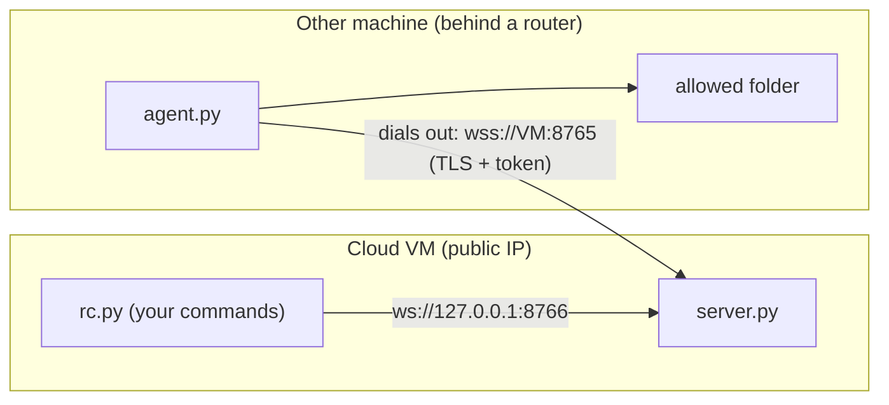

# agent-x-server

Let a cloud VM list, edit and run Python scripts on another machine, without SSH and without port forwarding on that machine.

## How it works



Only one side has to be reachable from the internet, and that is the VM. The other machine dials **out** to the VM, the same way a browser opens a website, so its router needs no configuration. Once that WebSocket is open it is two-way: the VM sends commands down the connection the other machine opened.

| File | Runs on | Job |
| --- | --- | --- |
| `server.py` | VM | Accepts the agent's connection on port 8765 and relays commands to it. |
| `rc.py` | VM | The command you type. Talks to `server.py` on localhost only. |
| `agent.py` | Other machine | Connects to the VM, then lists, reads, writes and runs files in one folder. |

## Setup

Both machines need Python 3.10+ and the one dependency:

```
pip install -r requirements.txt
```

### On the VM

1. Create a TLS certificate. Replace `1.2.3.4` with the VM's public IP.

   ```
   openssl req -x509 -newkey rsa:2048 -nodes -keyout key.pem -out cert.pem -days 3650 -subj "/CN=rc" -addext "subjectAltName=IP:1.2.3.4"
   ```

2. Create a secret token.

   ```
   python3 -c "import secrets; print(secrets.token_hex(32))"
   ```

3. Open TCP port 8765 in the cloud provider's firewall (and in `ufw`, if used). Port 8766 stays closed; it is local only.

4. Start the server.

   ```
   RC_TOKEN=<token> python3 server.py
   ```

### On the other machine

1. Copy `cert.pem` from the VM and put it next to `agent.py`. Do **not** copy `key.pem`.

2. Start the agent.

   ```
   RC_TOKEN=<token> RC_SERVER=wss://1.2.3.4:8765 python3 agent.py
   ```

   On Windows, set the variables first:

   ```
   set RC_TOKEN=<token>
   set RC_SERVER=wss://1.2.3.4:8765
   python agent.py
   ```

The agent retries every 5 seconds if the connection drops.

## Usage

Run these on the VM. Remote paths are relative to the agent's allowed folder.

| Command | What it does |
| --- | --- |
| `python3 rc.py ls [folder]` | List files. |
| `python3 rc.py cat <file> [range]` | Print a file. With a range, print only those lines: `10-20`, `10-` (line 10 to the end) or `10` (one line). Only those lines are sent over the network. |
| `python3 rc.py grep <pattern> [folder] [name-glob]` | Search inside files for a regular expression (a text pattern). Prints `path:line:text` for each match. Add `(?i)` at the start of the pattern to ignore upper and lower case. |
| `python3 rc.py glob <pattern> [folder]` | List files whose path matches a pattern such as `**/*.py`, newest first. |
| `python3 rc.py pull <remote> [local]` | Copy a file from the other machine. |
| `python3 rc.py push <local> [remote]` | Copy a file to the other machine. |
| `python3 rc.py edit <file>` | Open the file in `$EDITOR` (default `nano`) and save it back on exit. Creates the file if it does not exist. |
| `python3 rc.py replace <file> <old> <new>` | Replace a piece of text in a UTF-8 file. Fails if the text is missing or appears more than once. |
| `python3 rc.py run <script.py> [args]` | Run the script there and stream its output live. `rc.py` exits with the script's exit code. |

Pressing Ctrl-C during `run` also stops the script on the other machine.

`grep` and `glob` exit with code 1 when nothing matches, like the Unix `grep` command. Both stop at 1000 results.

### How search works

`grep` uses [ripgrep](https://github.com/BurntSushi/ripgrep) (`rg`) when it is installed on the other machine, and plain Python when it is not. Both skip hidden files and folders (names that start with `.`), binary files and symbolic links. A name glob without a `/`, such as `*.py`, matches file names in any folder. A glob with a `/`, such as `src/*.py`, matches paths from the allowed folder.

The two differ in a few ways:

- ripgrep also skips files listed in `.gitignore`. The Python version does not.
- Patterns use ripgrep's syntax or Python's syntax. Common patterns work the same in both.
- The Python version is slower on large folders.

`glob` always uses Python and includes hidden files.

`replace` matches the text exactly, including line endings. A file with Windows line endings (`\r\n`) needs `\r\n` in the text to match across lines.

## Settings

All settings are environment variables.

| Variable | Used by | Default | Meaning |
| --- | --- | --- | --- |
| `RC_TOKEN` | server, agent | required | Shared secret. Must match on both sides. |
| `RC_SERVER` | agent | none | `wss://<vm-ip>:8765` |
| `RC_ROOT` | agent | `~/remote-work` | The only folder the VM may touch. |
| `RC_CERT` | server, agent | `cert.pem` | TLS certificate. |
| `RC_KEY` | server | `key.pem` | TLS private key. |
| `RC_PORT` | server | `8765` | Public port the agent connects to. |
| `RC_CONTROL_PORT` | server, rc | `8766` | Local port `rc.py` uses. |

## Security

This tool is remote code execution by design, so three protections are built in.

- **Token:** the agent must send the shared token as its first message, or the server closes the connection.
- **TLS with a pinned certificate:** traffic is encrypted, and the agent trusts only the VM's own `cert.pem`, so it cannot be tricked into connecting to an impostor.
- **Folder restriction:** file commands are refused for any path outside `RC_ROOT`.

Limits to be aware of:

- **Scripts are not sandboxed.** The folder restriction covers file commands only. A script started with `run` can do anything the agent's user account can do.
- **Any user on the VM can send commands.** The control port is bound to localhost but has no password of its own.
- **Never commit `key.pem` or the token.** `.gitignore` already excludes the certificate files.

## Protocol

Messages are JSON over WebSocket.

The agent's first message is `{"token": "..."}`. After that, the server sends requests and the agent replies using the same `id`.

| Request | Fields | Final reply |
| --- | --- | --- |
| `ls` | `path` | `items`: list of `{name, dir, size}` |
| `read` | `path`, optional `start` and `end` (line numbers, from 1; `end` may be `null` for "to the end") | `data`: file contents, base64 |
| `grep` | `pattern`, `path`, optional `glob` | `matches`: list of `{path, line, text}`; `truncated`: true if results were cut off |
| `glob` | `pattern`, `path` | `files`: list of paths, newest first; `truncated` |
| `write` | `path`, `data` (base64) | none |
| `replace` | `path`, `old`, `new` | none |
| `run` | `path`, `args` | `code`: exit code |
| `kill` | `target`: id of a `run` request | no reply |

Every final reply has `"type": "done"` and `"ok": true`, or `"ok": false` with an `error` string. While a script runs, the agent also sends `{"type": "out", "data": "..."}` messages carrying its output.

Files and messages are limited to 64 MB.

## Design notes

- **Why not SSH?** SSH (plus Tailscale or a reverse tunnel for a machine behind a router) solves the same problem with no code. This project exists because SSH was ruled out.
- **Why WebSocket with the VM as server?** The VM has a public IPv4 address and root access, so it can listen on a port. The other machine cannot accept incoming connections, so it has to be the side that connects.
- **If neither side could listen:** both would need to dial out to a middleman, such as a tunnel (Cloudflare Tunnel, ngrok), a message broker (MQTT), or a small relay server.

## Status

Tested end to end on a single machine over localhost: list, read, line ranges, grep (with and without ripgrep), glob, replace, write, edit, run with live output, Ctrl-C stopping the remote script, and rejection of bad tokens and outside-folder paths. Not yet tested across a real network.
