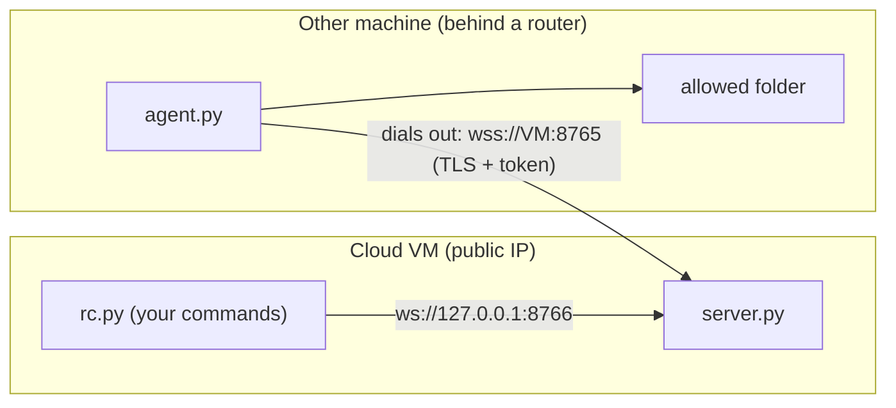

# agent-x-server

Let a cloud VM list, edit and run files on another machine, without SSH and without port forwarding on that machine.

## How it works



Only one side has to be reachable from the internet, and that is the VM. The other machine dials **out** to the VM, the same way a browser opens a website, so its router needs no configuration. Once that WebSocket is open it is two-way: the VM sends commands down the connection the other machine opened.

| File | Runs on | Job |
| --- | --- | --- |
| `server.py` | VM | Accepts the agent's connection on port 8765 and relays commands to it. |
| `rc.py` | VM | The command you type. Talks to `server.py` on localhost only. |
| `agent.py` | Other machine | Connects to the VM, then lists, reads, writes and runs files in one folder. Runs on Windows, Linux and macOS. |
| `mcp_server.py` | VM | Gives an AI agent on the VM tools to read, edit and run files on the other machine. Talks to `server.py` on localhost only. |

## Setup

Both machines need Python 3.10+ and the dependencies:

```
pip install -r requirements.txt
```

The `mcp` package is only used by `mcp_server.py` on the VM. The other machine can skip it and install only `websockets`.

### On the VM

1. Create a TLS certificate. Replace `1.2.3.4` with the VM's public IP.

   ```
   openssl req -x509 -newkey rsa:2048 -nodes -keyout key.pem -out cert.pem -days 3650 -subj "/CN=rc" -addext "subjectAltName=IP:1.2.3.4"
   ```

2. Create a secret token.

   ```
   python3 -c "import secrets; print(secrets.token_hex(32))"
   ```

3. Open TCP port 8765 in the cloud provider's firewall (and in `ufw`, if used). Port 8766 stays closed; it is local only.

4. Start the server.

   ```
   RC_TOKEN=<token> python3 server.py
   ```

### On the other machine

1. Copy `cert.pem` from the VM and put it next to `agent.py`. Do **not** copy `key.pem`.

2. Create `kucing-ag.json` next to `agent.py`:

   ```json
   {
     "server": "wss://1.2.3.4:8765",
     "token": "<token>",
     "root": "~/remote-work",
     "cert": "cert.pem"
   }
   ```

   `root` is the only folder the VM may touch. See [Settings](#settings) for the other places these values can come from.

3. Start the agent from that folder.

   ```
   python3 agent.py
   ```

The agent retries every 5 seconds if the connection drops. `python3 agent.py --show-config` prints each setting and where it came from, without connecting.

### Notes for each system

- **Windows:** in JSON, write paths as `C:/Users/me/work` or `C:\\Users\\me\\work`. A single backslash is an error. Use `python` instead of `python3`.
- **Linux and macOS:** the config file holds the token, so make it readable by you only: `chmod 600 kucing-ag.json`. The agent warns at startup if other users can read it.
- **macOS:** Python from python.org does not trust public certificates until you run **Install Certificates.command** in its Applications folder. This matters only when `cert` is unset (for example behind Cloudflare). If `root` is inside Documents, Desktop or Downloads, macOS asks you to allow access the first time.

### Starting the agent automatically

`service/` has a template for each system. Each file starts with its install steps. They start the agent when you log in and restart it if it stops. These templates have not been tested on a real machine yet.

| System | File |
| --- | --- |
| Linux (systemd) | `service/kucing-ag.service` |
| macOS (launchd) | `service/com.kucing-ag.agent.plist` |
| Windows (Task Scheduler) | `service/windows-task.ps1` |

## Usage

Run these on the VM. Remote paths are relative to the agent's allowed folder.

| Command | What it does |
| --- | --- |
| `python3 rc.py status` | Show whether the agent is connected, its folder, system, Python version, installed tools (`rg`, `git`) and named commands. |
| `python3 rc.py ls [folder]` | List files. |
| `python3 rc.py tree [folder] [-d depth]` | List files in all subfolders. Folders deeper than `depth` (default 3) are shown as one line with a file count. |
| `python3 rc.py stat <path>` | Show size, modified time and number of lines. |
| `python3 rc.py cat <file> [range]` | Print a file. With a range, print only those lines: `10-20`, `10-` (line 10 to the end) or `10` (one line). Only those lines are sent over the network. |
| `python3 rc.py grep [-C n] [-m n] [-l] <pattern> [folder] [name-glob]` | Search inside files for a regular expression (a text pattern). Prints `path:line:text` for each match. `-C n` also prints `n` lines around each match, as `path-line-text`. `-m n` stops after `n` matches per file. `-l` prints only file names. Add `(?i)` at the start of the pattern to ignore upper and lower case. |
| `python3 rc.py glob <pattern> [folder]` | List files whose path matches a pattern such as `**/*.py`, newest first. |
| `python3 rc.py pull <remote> [local]` | Copy a file from the other machine. |
| `python3 rc.py push <local> [remote]` | Copy a file to the other machine. |
| `python3 rc.py edit <file>` | Open the file in `$EDITOR` (default `nano`) and save it back on exit. Creates the file if it does not exist. |
| `python3 rc.py replace [--all] <file> <old> <new>` | Replace a piece of text in a file and print a diff. Fails if the text is missing, or appears more than once without `--all`. |
| `python3 rc.py mv <from> <to>` | Move or rename. Fails if the destination exists. |
| `python3 rc.py rm [-r] <path>` | Delete a file or an empty folder. `-r` deletes a folder with everything in it. |
| `python3 rc.py mkdir <folder>` | Create a folder. |
| `python3 rc.py git [-C folder] <command> [args]` | Run a read-only git command there: `status`, `diff`, `log`, `show`, `blame` or `ls-files`. |
| `python3 rc.py exec [-C folder] [name] [args]` | Run a command named in the agent's config (see [Named commands](#named-commands)). Without a name, list them. |
| `python3 rc.py run <script.py> [args]` | Run the script there and stream its output live. |

`git`, `exec` and `run` stream their output, and `rc.py` exits with the remote exit code. Pressing Ctrl-C also stops the process on the other machine, together with any processes it started.

`grep` and `glob` exit with code 1 when nothing matches, like the Unix `grep` command. `grep`, `glob` and `tree` stop at 1000 results.

Put `--json` right after `rc.py` to print the agent's raw reply as JSON, for example `python3 rc.py --json status`. Process output is in the `output` field.

### Named commands

`run` only starts Python scripts. To run anything else, such as a test suite, name the command line in the agent's config:

```json
{ "commands": { "test": "pytest -q", "lint": "ruff check ." } }
```

`python3 rc.py exec test` then runs `pytest -q` in the allowed folder, through the system's shell. Extra arguments are added to the end: `python3 rc.py exec test tests/test_api.py`. Names can only be added on the other machine, by editing its config.

### How search works

`grep` uses [ripgrep](https://github.com/BurntSushi/ripgrep) (`rg`) when it is installed on the other machine, and plain Python when it is not. Both skip hidden files and folders (names that start with `.`), binary files and symbolic links. A name glob without a `/`, such as `*.py`, matches file names in any folder. A glob with a `/`, such as `src/*.py`, matches paths from the allowed folder.

The two differ in a few ways:

- ripgrep also skips files listed in `.gitignore`. The Python version does not.
- Patterns use ripgrep's syntax or Python's syntax. Common patterns work the same in both.
- The Python version is slower on large folders.

`tree` follows the same rules as `grep`: it skips hidden files, and with ripgrep also files listed in `.gitignore`.

`glob` always uses Python and includes hidden files.

`replace` matches the text exactly, but it follows the file's line endings. In a file with Windows line endings (`\r\n`), line breaks in the old and new text are changed to `\r\n`, so you can type plain line breaks. The file keeps its encoding. `replace` handles UTF-8 (with or without a byte order mark), UTF-16 with a byte order mark, and otherwise the other machine's default encoding (on Windows, usually `cp1252`). A byte order mark is a few bytes at the start of a file that say which encoding it uses.

Python scripts started with `run` or `exec` always send their output as UTF-8, so characters like `é` show correctly on Windows too.

## Using it from an AI agent (MCP)

`mcp_server.py` lets an AI agent on the VM (Antigravity, Claude Code, or any other agent that supports MCP) read, edit and run files on the other machine. MCP (Model Context Protocol) is a standard way to give an AI agent tools. Each tool has named inputs, so the agent never has to put file contents inside a terminal command, where quotes and line breaks break easily.

The agent starts `mcp_server.py` itself and talks to it over standard input and output. `mcp_server.py` then talks to `server.py` on the local port, like `rc.py` does. `server.py` must be running and the other machine must be connected.

| Tool | What it does |
| --- | --- |
| `remote_status` | Check the connection. Shows the folder, system, installed tools and named commands. |
| `remote_ls` | List a folder. |
| `remote_tree` | List files in all subfolders, down to `depth` levels. |
| `remote_stat` | Size, modified time and number of lines of a file. |
| `remote_read` | Read up to 2000 lines, with line numbers. Takes `start_line` and `line_count`. Says which lines these are out of how many. |
| `remote_read_many` | Read the first 400 lines of up to 20 files in one call. |
| `remote_grep` | Search inside files. Takes `context_lines`, `max_per_file` and `files_only`. Same rules as `rc.py grep`. |
| `remote_glob` | Find files by path pattern, newest first. |
| `remote_replace` | Replace text that appears exactly once, or every occurrence with `replace_all`. Returns a diff. |
| `remote_edit` | Make several replacements in one file. Saves only if all of them apply. Returns a diff. |
| `remote_write` | Create a file or overwrite it completely. |
| `remote_mkdir`, `remote_move`, `remote_delete` | Create a folder, move or rename, delete. |
| `remote_git` | Read-only git: `status`, `diff`, `log`, `show`, `blame`, `ls-files`. |
| `remote_exec` | Run a [named command](#named-commands). Returns the output and exit code. |
| `remote_run` | Run a Python script in the allowed folder. Returns the output and exit code. |

`remote_exec` and `remote_run` stop the process after `timeout_seconds` (default 120) and return the output so far. Output longer than 30,000 characters keeps only the end.

### Adding it to Antigravity

In the agent panel, open the `...` menu, choose **Manage MCP Servers**, then **View raw config**. Add this entry, using the full paths on your VM:

```json
{
  "mcpServers": {
    "agent-x": {
      "command": "/full/path/to/python3",
      "args": ["/full/path/to/agent-x-server/mcp_server.py"]
    }
  }
}
```

If `RC_CONTROL_PORT` is not `8766`, add `"env": {"RC_CONTROL_PORT": "<port>"}` to the entry. Use the Python that has the dependencies installed (for example the one inside a virtual environment). Then click refresh in **Manage MCP Servers**.

### Adding it to Claude Code

```
claude mcp add agent-x -- /full/path/to/python3 /full/path/to/agent-x-server/mcp_server.py
```

## Settings

The agent reads `server`, `token`, `root` and `cert` from, in order (first one found wins):

1. **Local config:** `kucing-ag.json` in the directory you run `agent.py` from
2. **Global config:** `~/.kucing-ag/config.json` (on Windows, `C:\Users\<you>\.kucing-ag\config.json`)
3. **Environment variables** (`RC_SERVER`, `RC_TOKEN`, `RC_ROOT`, `RC_CERT`)

```json
{
  "server": "wss://1.2.3.4:8765",
  "token": "<token>",
  "root": "~/remote-work",
  "commands": { "test": "pytest -q" }
}
```

A file may hold only some of the keys; the rest come from the next place. `commands` can only be set in the config files. If both files have it, the lists are joined and the local file wins for a name in both.

`kucing-ag.json` is in `.gitignore` because it holds the token. Everything else below is an environment variable only.

| Variable | Used by | Default | Meaning |
| --- | --- | --- | --- |
| `RC_TOKEN` | server, agent | required | Shared secret. Must match on both sides. |
| `RC_SERVER` | agent | none | `wss://<vm-ip>:8765` |
| `RC_ROOT` | agent | `~/remote-work` | The only folder the VM may touch. |
| `RC_CERT` | server, agent | server: `cert.pem`; agent: none | TLS certificate. On the agent, leave it unset to trust public certificates (needed behind Cloudflare). |
| `RC_KEY` | server | `key.pem` | TLS private key. |
| `RC_PORT` | server | `8765` | Public port the agent connects to. |
| `RC_CONTROL_PORT` | server, rc, mcp_server | `8766` | Local port `rc.py` and `mcp_server.py` use. |

## Security

This tool is remote code execution by design, so three protections are built in.

- **Token:** the agent must send the shared token as its first message, or the server closes the connection.
- **TLS with a pinned certificate:** traffic is encrypted, and the agent trusts only the VM's own `cert.pem`, so it cannot be tricked into connecting to an impostor.
- **Folder restriction:** file commands are refused for any path outside the agent's `root`.

Limits to be aware of:

- **Scripts are not sandboxed.** The folder restriction covers file commands only. A script started with `run` can do anything the agent's user account can do, and the VM can write that script itself. So named commands and the read-only `git` list are a convenience, not a security boundary.
- **Any user on the VM can send commands.** The control port is bound to localhost but has no password of its own.
- **Never commit `key.pem` or the token.** `.gitignore` already excludes the certificate files.

## Protocol

Messages are JSON over WebSocket.

The agent's first message is `{"token": "...", "protocol": 2}`. The server closes the connection with code 4001 for a wrong token and 4002 for a different protocol number. After that, the server sends requests and the agent replies using the same `id`.

| Request | Fields | Final reply |
| --- | --- | --- |
| `info` | none | `protocol`, `root`, `os`, `python`, `tools`: `{rg, git}` as true or false, `commands`: `{name: command line}` |
| `ls` | `path` | `items`: list of `{name, dir, size}` |
| `tree` | `path`, optional `depth` (default 3) | `entries`: list of `{path}` for files and `{path, files}` for folded folders; `truncated` |
| `stat` | `path` | `dir`, `size`, `modified`, and `lines` for text files |
| `read` | `path`, optional `start` and `end` (line numbers, from 1; `end` may be `null` for "to the end") | `data`: file contents, base64; with `start`, also `lines`: total lines in the file |
| `grep` | `pattern`, `path`, optional `glob`, `context`, `max_per_file`, `files_only` | `matches`: list of `{path, line, text}`, with `context: true` on context lines; or `files` when `files_only` is set; `truncated`: true if results were cut off |
| `glob` | `pattern`, `path` | `files`: list of paths, newest first; `truncated` |
| `write` | `path`, `data` (base64) | none |
| `replace` | `path`, and either `old`, `new`, optional `all`, or `edits`: list of `{old, new, all}` | `diff`: the change as a unified diff |
| `mkdir` | `path` | none |
| `mv` | `path`, `to` | none |
| `rm` | `path`, optional `recursive` | none |
| `git` | `path` (folder), `args` (first one is the git command) | `code`: exit code |
| `exec` | `name`, `args`, `path` (folder) | `code`: exit code |
| `run` | `path`, `args` | `code`: exit code |
| `kill` | `target`: id of a `git`, `exec` or `run` request | no reply |

Every final reply has `"type": "done"` and `"ok": true`, or `"ok": false` with an `error` string. While a process runs, the agent also sends `{"type": "out", "data": "..."}` messages carrying its output.

Files and messages are limited to 64 MB.

## Design notes

- **Why not SSH?** SSH (plus Tailscale or a reverse tunnel for a machine behind a router) solves the same problem with no code. This project exists because SSH was ruled out.
- **Why WebSocket with the VM as server?** The VM has a public IPv4 address and root access, so it can listen on a port. The other machine cannot accept incoming connections, so it has to be the side that connects.
- **If neither side could listen:** both would need to dial out to a middleman, such as a tunnel (Cloudflare Tunnel, ngrok), a message broker (MQTT), or a small relay server.

## Tests

```
python3 test_smoke.py
```

This starts `server.py` and `agent.py` on one machine with a throwaway certificate and tries every command through `rc.py` and the MCP tools. It needs the `openssl` command. `make setup` creates a virtual environment with the dependencies, and `make test` runs the test in it.

## Status

Tested end to end on a single Linux machine over localhost with `test_smoke.py`, with and without ripgrep. `pull`, `push` and `edit` are not covered by that test. Not yet tested on Windows or macOS, or across a real network.
